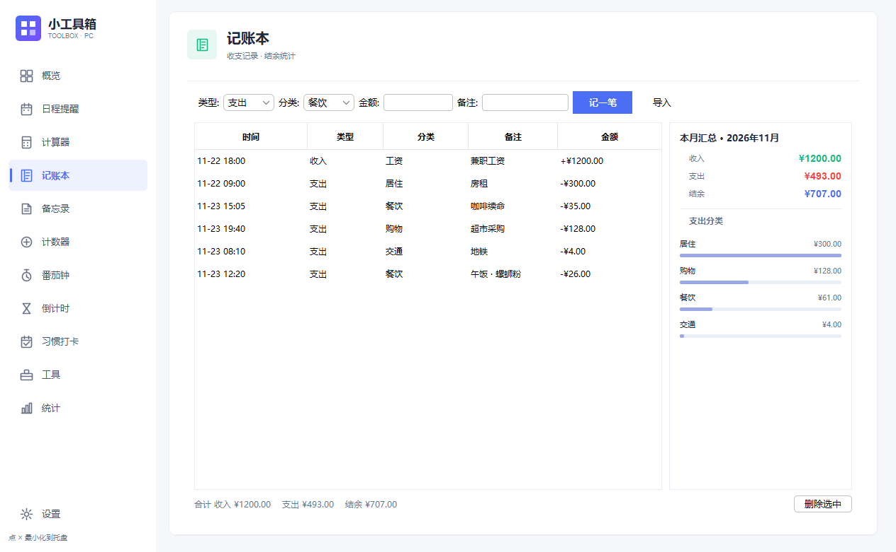

# 小工具箱 PC 版

一个纯 Java Swing 写的 Windows 桌面小工具集：日程提醒、记账、习惯打卡、番茄钟、倒计时、备忘录、统计看板等 12 个页面。
数据全部是本地 txt，不联网、不注册账号、不写注册表，解压即用。

> 当前版本 **v2.4**（2026-11）


---

## 功能一览

| 页面 | 能干什么 |
| --- | --- |
| 概览 | 今日待办、逾期提醒、今日专注、本月收支一屏看完；每个数字都能点进去看明细 |
| 日程提醒 | 一次性 / 每天 / 每周 / 每月 / 每年重复的日程，到点弹窗提醒，支持稍后提醒 |
| 计算器 | 表达式计算，带历史记录，可点结果回填 |
| 习惯打卡 | 每日打卡、连续天数、补卡、月度打卡格子图 |
| 记账本 | 收支记账、分类统计、按日期筛选；支持把任意格式的账单文本**导入**并预览 classify 后的结果 |
| 备忘录 | 便签式记录，支持搜索、置顶、置顶到桌面小窗 |
| 计数器 | 多个独立计数器，一键 +1 / -1，到目标提醒 |
| 番茄钟 | 25 分钟专注 + 休息循环，记录每轮专注的任务名与时长 |
| 倒计时 | 多个倒计时并行，到点响铃，可预设常用时长 |
| 工具 | 文件整理（按类型/日期归类）、文本工具（去重、大小写、统计字数等） |
| 统计 | 专注时长、番茄数、支出趋势、完成率等看板；每张卡都能点开看明细 |
| 设置 | 声音、强提醒、窗口置顶、导航顺序、数据目录、备份管理、导入记忆管理 |

**桌面小窗**：待办清单可以钉在桌面右下角，不抢焦点，随时看一眼还有什么没做。

### 几个页面长什么样

| 记账本 | 统计 |
| --- | --- |
|  |  |

| 番茄钟 |
| --- |
|  |

---

## 技术栈

- JDK 17（`javac` 编译，无构建工具依赖）
- Java Swing + 自绘组件（图表、日历、卡片全部自己画，无第三方 UI 组件）
- [FlatLaf](https://github.com/JFormDesigner/FlatLaf) 3.5.4（浅色 / 深色主题）
- `jpackage` 打成免安装 `app-image`（自带精简 JRE，双击 exe 即用）

约 1.8 万行 Java，34 个源文件。

---

## 目录结构

```
ToolboxPC/
├─ src/com/toolbox/pc/     # 全部源码
│  ├─ Main.java            # 主窗口、导航、页面注册
│  ├─ Store.java           # 数据读写（txt 落盘 + 原子替换）
│  ├─ Backup.java          # 每日快照 / 手动备份 / 回滚 / 按模块勾选
│  ├─ Theme.java, Ui.java  # 配色、字体、圆角与阴影
│  └─ *Panel.java          # 12 个页面
├─ shot/                   # 自测与出图工具（FeatureTest*.java、run_regression.ps1）
├─ lib/                    # 放 flatlaf.jar（见下）
├─ build/app.ico           # 程序图标
└─ README.md
```

---

## 从源码运行

1. 装 JDK 17，`java -version` 能看到 17。
2. 下载 FlatLaf 3.5.4，放到 `lib/flatlaf.jar`：

   https://repo1.maven.org/maven2/com/formdev/flatlaf/3.5.4/flatlaf-3.5.4.jar

3. 编译并运行（PowerShell）：

```powershell
$jdk = "C:\path\to\jdk-17"
$srcs = Get-ChildItem .\src -Recurse -Filter *.java | ForEach-Object { $_.FullName }
& "$jdk\bin\javac.exe" -encoding UTF-8 -cp .\lib\flatlaf.jar -d .\build\classes $srcs
& "$jdk\bin\java.exe" -cp ".\build\classes;.\lib\flatlaf.jar" com.toolbox.pc.Main
```

---

## 打包成免安装 exe

```powershell
& "$jdk\bin\jar.exe" cfe .\build\input\toolbox.jar com.toolbox.pc.Main -C .\build\classes .
Copy-Item .\lib\flatlaf.jar .\build\input\
& "$jdk\bin\jpackage.exe" --type app-image --name 小工具箱PC `
  --input .\build\input --main-jar toolbox.jar --main-class com.toolbox.pc.Main `
  --icon .\build\app.ico --dest .\dist
```

产物是 `dist\小工具箱PC\小工具箱PC.exe`，整目录拷走就能用，不用装 JRE。

---

## 数据与备份

数据目录按以下顺序解析，全部是普通文本文件，可以直接用记事本改：

1. 启动参数 `-Dtoolbox.data.dir=<目录>`
2. 环境变量 `TOOLBOX_DATA`
3. 默认 `%USERPROFILE%\ToolboxPC\`

主要文件：`settings.txt`、`todo.txt`、`schedule.txt`、`memo.txt`、`ledger.txt`、`ledgermap.txt`、`habit.txt`、`health.txt`、`pomodoro.txt`、`pomodoro_log.txt`、`counter.txt`、`eye.txt`、`countdown_log.txt`、`countdown_presets.txt`。

**备份**（v2.3 起）：

```
backups\
├─ 2026-11-23\             # 每天第一次打开自动留一份
├─ 2026-11-23-171521\      # 手动「立即备份一份」
└─ pre-restore-2026-11-23-173122\   # 回滚前自动把当前状态另存
```

- 只保留最新 10 份，更早的自动清掉。
- v2.4 起可以按模块勾选备份范围（记账本 / 备忘录 / 日程与待办 / 习惯与健康 / 番茄与倒计时 / 计数器与用眼），勾完从下一份快照开始生效。
- 回滚前一定先 `pre-restore` 留底，回滚后不满意可以再滚回去。

**导入记忆**（v2.3 起）：记账本导入时会把「备注 → 分类」的对应关系记到 `ledgermap.txt`，下次同样的写法自动套用分类；设置页可以查看、改分类、删除某条记忆。

---

## 自测

`shot/` 下有 78 个 `FeatureTest*.java`（累计断言 1500+ 条），以及一键回归脚本：

```powershell
.\shot\run_regression.ps1                    # 跑全部 33 套
.\shot\run_regression.ps1 -Only "FeatureTest76","FeatureTest77"   # 只跑某几套
```

脚本会把数据目录隔离到 `%TEMP%` 下，不会动你真实的数据；每套结束打印 `ALL PASS`。

界面验收用同一个 JVM 离屏 `printAll` 出图（`ShotV23.java` / `ShotV24.java`），不需要人工点。

---

## 版本记录

| 版本 | 内容 |
| --- | --- |
| v2.4 | 备份按模块勾选；导入记忆可改分类 / 删除；统计页新增「数据备份」卡 |
| v2.3 | 每日快照 + 回滚；导入分类记忆；番茄卡点击联动番茄记录 |
| v2.2 | 设置不再丢失（`settings.bak`）；数据目录可隔离 |
| v2.1 | 记账本支持任意格式账单导入 |
| v2.0 | 5 个缺陷修复 + 3 个体验增强 |
| v1.7x | 导航、统计看板、桌面小窗、深浅色主题等基础功能 |

---

## 说明

个人自用工具，Windows 上测试。图标、配色、字体都按中文 Windows 默认环境调过；换到 Linux/macOS 能跑但排版会有出入。
